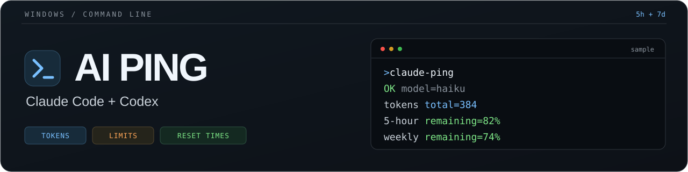

<p align="center">
  <a href="#windows-requirements"></a>
  <a href="#linux"></a>
  <a href="#windows-requirements"></a>
  <a href="LICENSE"></a>
</p>

<p align="center"><strong>English</strong> · <a href="README.ru.md">Русский</a></p>

# AI Ping

**Minimal requests to Claude Code and Codex on Windows and Linux — with the current account, token usage, and quota reset times.**

AI Ping checks subscription access with short model requests and shows the current account email, request token counts, remaining 5-hour and weekly quotas, and server reset countdowns. Run it manually, through Windows Task Scheduler, or through Linux cron to start an inactive usage window ahead of work.

[Quick start](#quick-start) · [Linux](#linux) · [Usage](#usage) · [Example output](#example-output) · [Scheduling](#scheduling) · [License](#license)

## Quick start

Choose the command for your terminal.

**Linux / WSL:**

```bash
curl -fsSL https://raw.githubusercontent.com/dprytkov/ai-ping/main/install.sh | bash
```

Works across Linux distributions with the required dependencies; see [Linux](#linux) for dependencies and scheduling.

**Windows PowerShell (5.1 / 7):**

```powershell
irm https://raw.githubusercontent.com/dprytkov/ai-ping/main/install.ps1 | iex
```

**Windows CMD:**

```bat
curl -fsSL https://raw.githubusercontent.com/dprytkov/ai-ping/main/install.bat -o install.bat && install.bat && del install.bat
```

On Windows, the installer saves a GitHub ZIP archive to disk, extracts it, and installs `ai-ping`, `claude-ping`, and `codex-ping` into `%USERPROFILE%\.local\bin`. It adds that folder to your user `PATH` without duplicates and removes the temporary archive folder. PowerShell also removes its temporary launcher; CMD deletes `install.bat` after a successful installation.

The MIT notice is installed beside the commands as `ai-ping-LICENSE.txt`.

**No Git or administrator access required.** Repeat the command to update. Open a new terminal when installation finishes:

```bat
ai-ping
```

<details>
<summary>Install from a clone or ZIP</summary>

```powershell
git clone https://github.com/dprytkov/ai-ping.git
cd ai-ping
.\ai-ping-setup.bat
```

Or [download the ZIP](https://github.com/dprytkov/ai-ping/archive/refs/heads/main.zip), extract it, and run `ai-ping-setup.bat`. Keep it beside all three ping scripts and `LICENSE`.

To inspect the internet installers first, review [install.ps1](install.ps1), [install.bat](install.bat), or [install.sh](install.sh).

</details>

## Linux

Requirements: Linux x86_64 (including WSL), Bash, Python 3.8+, cron with `crontab`, `flock`, coreutils, awk, grep, curl, tar, gzip and tzdata. Enable your distribution's cron service. WSL must remain running for scheduled pings.

1. Run the installer as the user who will own the schedule (without sudo):

   ```bash
   curl -fsSL https://raw.githubusercontent.com/dprytkov/ai-ping/main/install.sh | bash
   ```

2. Choose the first daily time and provider. For Codex, open the displayed URL and enter the one-time code to sign in to ChatGPT. The installer downloads the official CLI, checks its SHA-256, and creates a dedicated server session. A new login sends one small verification ping; repeated setup reuses the session. For Claude without its CLI, paste a token from `claude setup-token` on your Windows computer; it permits pings but not quota lookup.

Open a new terminal and run `codex-ping` or `ai-ping`. No token copying or separate refresh timer is needed for Codex: each ping checks the local expiry and uses the official CLI to renew only when necessary. The web panel is optional and reads the same server session.

From a clone or ZIP, run `bash ai-ping-setup.sh --start 06:00 --provider both`. Defaults are **06:00, 11:01, 16:02, 21:03 Europe/Moscow**, regardless of the server's time zone. Use `--start`, `--provider`, `--timezone`, `--claude-model` and `--codex-model` to change them. Repeat setup to update scripts or the schedule; unrelated cron jobs are preserved. New logins require browser confirmation even when setup is launched noninteractively.

Commands and Python modules are installed in `~/.local/bin`. The dedicated Codex CLI lives in `~/.local/lib/ai-ping/codex`, outside PATH; its only active auth file is `~/.local/state/ai-ping/codex/auth.json` (mode `600`). Unset `CODEX_HOME` during setup; existing personal CLI profiles are not overwritten. Existing imported profiles remain usable, but do not renew automatically.

```bash
codex-ping gpt-5.6-luna
crontab -l
tail -n 40 ~/.local/state/ai-ping/ai-ping.log
```

If the server session is revoked, run `python3 ~/.local/bin/ai-ping.py --codex-login` and confirm a new code. To stop scheduled pings, remove the marked AI-PING block with `crontab -e`. [Auth storage, recovery and migration](codex-auth.md) · [Detailed guide (Russian)](ai-ping.md#linux).

## Web panel

The optional [web panel](web/README.md) provides manual Claude/Codex pings, account selection, Windows authorization import, a shared schedule, and the existing AI Ping log. It uses the installed Linux ping commands and shares their cron lock. Login uses a password form and a session cookie; imported accounts stay outside the schedule until selected. Up to 12 accounts are supported, including two built-in server accounts.

Deploy it separately on an Ubuntu/Debian server with AI Ping installed for root, authorization for both providers, an existing cron entry, and an HTTPS Nginx vhost. Ordinary installers do not deploy the panel. From `web` on that server:

```sh
sudo python3 deploy.py --host panel.example.com --vhost /etc/nginx/sites-enabled/panel.conf
```

Replace the example domain and vhost path with your own. Deployment backs up changed files, preserves existing panel accounts/settings, and checks HTTPS login without making model requests. First deployment starts with **06:00, 11:01, 16:02, 21:03 Europe/Moscow**; change the times, models and participants in the panel. Its settings then control the schedule. After updating the base Linux installation, redeploy the panel to restore its cron wrapper. See the [panel guide](web/README.md) for requirements, Windows import, storage and rollback.

## Windows requirements

- Windows with **Windows PowerShell 5.1** and an internet connection.
- `curl.exe` and `tar.exe` on `PATH` for the internet installer.
- The relevant CLI, signed in with a subscription account that supports your chosen model.
- Claude Code with `--safe-mode` and `--effort` support; tested with version **2.1.289**.

**Sign in:** run `claude` and use `/login`, or run `codex login`. Installers do not install the CLIs or sign you in; Linux setup can import Windows authorization when a CLI is missing. The Windows installer does not create scheduled tasks; Linux setup creates the cron schedule described above.

On Windows, `FAIL: Claude authentication failed` means you need to run `claude auth login` and complete sign-in in your browser, then retry `claude-ping`. A missing OAuth token for quota lookup is reported separately; reinstalling AI Ping does not restore a Claude session.

## Usage

Run `ai-ping` without arguments to ping Codex, then Claude, with their default models on Windows or Linux. Both are attempted even if one fails. It exits with `0` only when both succeed; otherwise `1`. Use the individual commands below to choose a model.

| Command | Default model | Request |
| --- | --- | --- |
| `ai-ping` | Both defaults below | Runs Codex, then Claude; attempts both even if one fails |
| `claude-ping` | `haiku` | Short system prompt, safe mode, low effort; tools and MCP disabled |
| `codex-ping` | `gpt-5.6-luna` | Direct request with low reasoning effort; CLI fallback on HTTP 401 |

Pass a model name as the only argument:

```bat
claude-ping sonnet
codex-ping gpt-5.6-sol
```

Every run makes a **real model request and consumes account usage**. Model availability depends on your account. If a default model is unavailable, pass a supported name.

Claude disables thinking where the model supports it. These settings apply only to the ping process. Another ping does not move the reset time of an active usage window.

## Example output

Illustrative Claude output:

```text
[2026-10-05 10:00:00] OK: 'ok'
  login=claude-user@example.com
  model=haiku
  TOKENS
  input=20  output=3  total=83
  cache_write=10  cached=50

  LIMITS
  5-hour    [##------------------]  remaining=87.5%  used=12.5%
            resets=2026-10-05 12:00:00 +03:00
            in 0d 01:59:59

  weekly    [#######-------------]  remaining=65%  used=35%
            resets=2026-10-10 10:00:00 +03:00
            in 4d 23:59:59
```

| Field | Meaning |
| --- | --- |
| `login` | Current provider account email; `unavailable` if identity metadata is missing |
| `TOKENS` | Token counts for this ping, including cache statistics |
| `used` / `remaining` | Account quota percentages, not exact remaining token counts |
| `resets` | Server reset time in the machine's local time zone |
| `in` | Countdown in days and `HH:MM:SS` |
| `n/a` / `unknown` | The service did not return a value |

Claude adds uncached input, cache writes, cache reads, and output to get `total`. Codex includes cached tokens in input and reasoning tokens in output, so neither is added a second time. Quota statistics requests do not generate model responses.

**Exit codes:** `0` means success; `1` means failure. If the ping succeeds but quota statistics are unavailable, a warning is printed and the exit code remains `0`.

On Windows, both pings retrieve quota statistics after a failed request. When the provider reports exhausted usage limits, they print `LIMIT: quota exhausted. Try again after reset.` followed by `LIMITS` with remaining percentages and server reset times. Other failures keep `FAIL`; unavailable statistics produce a warning. The exit code stays `1` because the ping did not succeed.

## Scheduling

Example: run Claude Ping daily at **07:00 local time** while signed in to Windows. Run in PowerShell:

```powershell
$action = New-ScheduledTaskAction -Execute 'cmd.exe' -Argument '/c "%USERPROFILE%\.local\bin\claude-ping.bat"'
$trigger = New-ScheduledTaskTrigger -Daily -At '07:00'
$settings = New-ScheduledTaskSettingsSet -StartWhenAvailable -RunOnlyIfNetworkAvailable
Register-ScheduledTask -TaskName 'claude-ping' -Action $action -Trigger $trigger -Settings $settings
```

Use `codex-ping` in the task name and script path for Codex. [The detailed Russian guide](ai-ping.md#запуск-по-расписанию) covers multiple triggers, logging, and task management.

## Troubleshooting

| Symptom | Check |
| --- | --- |
| CLI or ping command not found | Verify installation and `PATH`; open a new terminal |
| Authentication failure | Sign in again: `claude` → `/login`, or `codex login`; without a Linux CLI, repeat setup and paste fresh Windows authorization |
| Model unavailable | Pass a model supported by your account |
| Quota warning | Check the connection and subscription sign-in |
| Antivirus warning | Keep protection enabled; review the files and detection instead of adding exclusions |

The internet installers save files to disk before running local setup. Authentication stays in the user's profile and is excluded from Git. Linux Codex prefers its dedicated `~/.local/state/ai-ping/codex/auth.json`; an explicit `CODEX_HOME` selects the legacy CLI profile. Without a dedicated session, existing CLI/imported credentials retain their previous behavior. Claude uses its CLI profile or imported AI Ping credentials. Never publish auth files or refresh tokens.

## Development

There is no build step. Offline checks use mocked CLIs, HTTP responses, ZIP fixtures, and an isolated registry. They do not make model requests or use real credentials.

```powershell
powershell -NoProfile -ExecutionPolicy Bypass -File .\test-claude-ping.ps1
powershell -NoProfile -ExecutionPolicy Bypass -File .\test-codex-ping.ps1
powershell -NoProfile -ExecutionPolicy Bypass -File .\test-install.ps1
powershell -NoProfile -ExecutionPolicy Bypass -File .\test-ai-ping.ps1
```

Linux checks use isolated homes, mocked crontab/CLI commands, local archives, and HTTP fixtures:

```bash
python3 test-linux.py
bash test-linux.sh
```

Web panel offline checks (Linux):

```sh
cd web
python3 -m unittest -v test_web.py test_profiles.py test_deploy.py
sh -n ai-ping-run.sh
```

[Report a problem](https://github.com/dprytkov/ai-ping/issues) with the command, Windows/CLI versions, and sanitized output. Redact your login email before sharing logs.

## License

[MIT](LICENSE) · Copyright © 2026 [dprytkov](https://github.com/dprytkov).

---

<p align="center"><a href="README.ru.md">Русская версия</a> · <a href="ai-ping.md">Detailed Russian guide</a></p>
